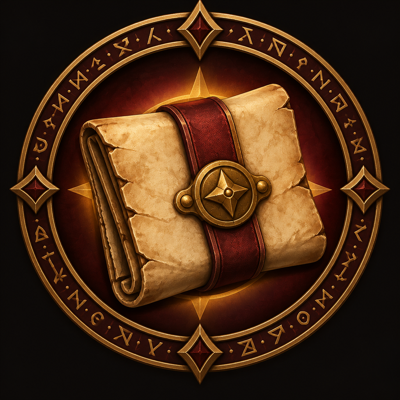

# Quest Fold

> **Fold it. Forget it.**

A lightweight World of Warcraft addon that makes collapsed objective tracker headers sticky.

## Why

You collapse the trackers you don't care about right now, and the game keeps opening them back up. Quest Fold remembers what you folded, so your objective tracker stays the way you left it.

## Features

- Collapsed objective tracker headers stay collapsed, even after a reload: All Objectives and each tracker (quests, campaign, world quests, achievements, ...).
- Alt+Click the All Objectives button to collapse or expand every tracker at once.
- Tooltips on the collapse buttons show what a click does.
- A short help tour shows new users how it works, once.
- Available in English, German, French, Spanish, Italian, Portuguese (Brazil), Russian, Korean and Chinese (Simplified and Traditional).
- Works out of the box: no setup, no options to configure.
- Lightweight: does one thing and stays out of your way.

## Supported Versions

- Retail
- WoW Forever

Classic flavors aren't supported: their objective tracker works differently.

## Feedback

Found a bug or have an idea? [Open an issue](https://github.com/kapresoft/wow-quest-fold/issues).

## License

[MIT](LICENSE)

### Donations

If Quest Fold has made your questing easier, consider supporting its development:

- **[Paypal&trade; Donation](https://www.paypal.com/donate/?hosted_button_id=AX58YP3GSGXVU)**
- **[Bitcoin Donation](https://www.blockchain.com/btc/address/3QQVAwJGkKHMM2oq6CLVWYgfx83TFVwp39)**

## About

- About the Author [(Tony Lagnada)](https://tony.resume.lagnada.com/)
- My AddOn Portfolio Can Be Found Here [Curse Forge/Kapresoft](https://www.curseforge.com/members/kapresoft/projects)
- Addon videos and demos on [YouTube](https://www.youtube.com/channel/UC8xQy0wlMBLTvvAcvehz0Kg)
